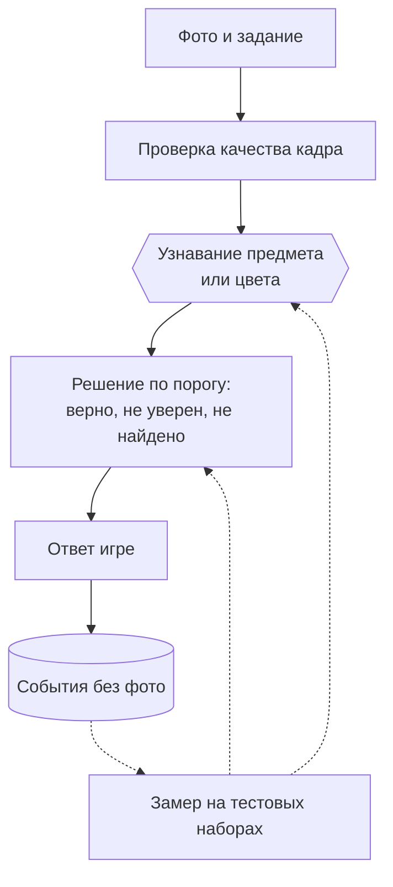

# ML System Design Doc — «Английский вокруг нас»: игра с проверкой по фото для детей 2–7 лет

**Автор:** Плехов Родион Константинович, ИТМО · **Версия:** 1.0 · **Дата:** 2026-10-25

## 1. Цели и предпосылки

### 1.1. Зачем идём в разработку продукта?

Дошкольники знакомятся с английскими словами по карточкам и картинкам, без связи с предметами вокруг, и интерес быстро пропадает. Игра устроена так: персонаж по-русски просит найти дома предмет или цвет, ребёнок фотографирует находку, игра проверяет фото, и тогда звучит английское слово. Метод опирается на обучение через действие (Total Physical Response).

**Цель:** вовлечь ребёнка и связать английское слово с настоящим предметом, который он нашёл сам.

| Цепочка эффекта | |
|---|---|
| Проблема | Слова без контекста, интерес быстро пропадает |
| Решение | Игра: задание, поиск, фото, проверка, английское слово |
| Действие | Игра засчитывает находку или просит попробовать ещё |
| Эффект | Больше слов услышано в связке с настоящим предметом |
| Деньги | Не рассматриваются: ценность определяется вовлечением, которое ещё нужно измерить |

**Нужен ли ML.** Без проверки засчитывалось бы любое фото, и смысл «слово связано с предметом» пропадает. Проверка требует понимать изображение, правилом её не заменить. Английское слово и озвучка модели не требуют.

**Какие подходы к проверке сравниваются.** Классификатор по готовому списку классов; модель сопоставления фото и текста; серверная мультимодальная модель. Подходы сравниваются **офлайн, на тестовых наборах фото, без участия пользователей**: оценивается, как каждая модель находит предмет и как часто путает (раздел 2.3).

**Успех итерации:** модель редко принимает чужой предмет и редко отклоняет правильный. Пороги фиксируются после замера бейзлайна.

### 1.2. Бизнес-требования и ограничения

**Процесс игры:** ребёнок получает задание, находит предмет дома, фотографирует его, игра проверяет фото, и звучит английское слово.

| № | Требование |
|---|---|
| БТ-1 | Задание по-русски: текст, картинка, озвучка |
| БТ-2 | Съёмка камерой устройства без установки приложения |
| БТ-3 | Проверка, что на фото нужный предмет или цвет |
| БТ-4 | Понятный ребёнку ответ |
| БТ-5 | После верного фото звучит английское слово |

**Ограничения.**
- Дети 2–7 лет и их дома: фото не должно без необходимости покидать устройство, снимки не хранятся; игра идёт со взрослым рядом (152-ФЗ).
- Каждое задание должно находиться в обычной квартире: ребёнок не должен застревать на предмете, которого нет дома.
- Задания только из утверждённого безопасного списка.
- Лицензии моделей и данных проверяются по каждому источнику, ведётся реестр; для Wikimedia Commons лицензия проверяется у каждого файла.

**Ожидания от итерации.** К концу итерации должны быть получены: способ, которым игра определяет предмет на фото, выбранный по сравнению на тестовых фото из открытых наборов; порог, по которому фото засчитывается; список слов для игры.

**Бизнес-процесс пилота.** Игру проверяют на реальных пользователях: дети с родителями. Пилот вне этой итерации.

**Что считается успешным результатом.** Модель верно определяет предметы на тестовых фото из открытых наборов: нужный предмет узнаётся заметно чаще, чем у бейзлайна, а чужие предметы принимаются редко. Конкретные значения фиксируются после замера бейзлайна. Пилот на реальных пользователях вне этой итерации. Дальше: новые наборы слов.

### 1.3. Скоуп итерации

**Закрываются БТ-1–БТ-5** для закрытого списка заданий. Входит: состав заданий по методике, сравнение подходов к проверке на тестовых наборах, решающее правило и пороги, английское слово после находки.

**Не входит:** обучение на снимках детей; распознавание речи; режим «сфотографируй что угодно» и проверка слов ребёнком по сфотографированным картинкам (не в MVP); аккаунты; серверная обработка снимков детей; пилот.

**Воспроизводимость.** Скрипты замеров в репозитории, версии моделей, наборов и порогов фиксируются, замеры запускаются при каждом изменении правил.

**Технический долг:** нет аналитики после запуска; нет замеров на слабых устройствах.

### 1.4. Предпосылки решения

- Набор заданий закрытый и расширяется; правило должно уметь «этот предмет, а не соседний».
- Детских данных для обучения нет, и храниться они не будут: старт без обучения (zero-shot).
- Цена ошибок несимметрична: ложное «верно» учит неправильному, ложное «неверно» огорчает.
- Дошкольники снимают нечётко (дрожание, ракурс, свет): тесты имитируют это искусственными искажениями.
- Слова для игры берутся из того, что учат дети, и должны находиться в обычной квартире (2.3, этап 1).

## 2. Методология

### 2.1. Постановка задачи

По фото и заданию (например, «Найди ложку!») система решает, есть ли в кадре нужный предмет или цвет. Система выбирает один из трёх ответов: **верно** (нужный предмет или цвет на фото подтверждён), **не уверен** (просим переснять: ближе или с другого ракурса) или **не найдено** (новая попытка). Слово засчитывается только при ответе «верно». Метрики:
- **узнавание:** доля фото нужного предмета, получивших «верно» для своего задания;
- **ложное принятие по заданию:** доля фото без этого предмета, получивших «верно» для данного задания;
- **путаница:** матрица ответов «верно» для заданий списка на фото других предметов из списка;
- **посторонние предметы:** доля фото предметов вне списка, получивших «верно» хотя бы для одного задания;
- время ответа и потребление ресурсов.

### 2.2. Блок-схема решения

| Блок | Бейзлайн | MVP |
|---|---|---|
| Узнавание | Классификатор по готовому списку классов (ImageNet-подобный) и детектор | Модель сопоставления фото и текста (zero-shot) плюс детектор для мелких предметов; цвет по пикселям |
| Решение | Порог «первые k» | Порог по оценке сходства (softmax по заданиям, «фону» и «чужим предметам»), три исхода |
| Английское слово | Запись диктора | Запись диктора или синтез (по проверке произношения) |
| Потолок для сравнения | — | Серверная мультимодальная модель на чужих фото (только для замеров) |

### 2.3. Этапы решения задачи

#### Этап 1. Состав заданий

**Методика.** Слова должны быть теми, что учат дети, а предметы доступны дома.
- **Что учат дети.** Опорные тематические списки для детей: Cambridge Pre A1 Starters, темы «дом», «еда и напитки», «одежда», «игрушки», «школа» и др. Это ориентир, а не стандарт для 2–7 лет: экзамен рассчитан на 6–12 лет.
- **Как учат.** Слово связывается с действием и предметом (TPR), поэтому берутся конкретные осязаемые предметы, а не абстрактные слова.

**Критерии отбора предмета:**
1. слово есть в тематических списках для детей;
2. предмет осязаемый, называется одним словом, безопасный;
3. предмет есть почти в каждой квартире (отбираются повседневные предметы по комнатам);
4. ребёнок может его принести или снять без помощи со стремянки;
5. предмет узнаётся моделью (проверка E1).

**Порядок.** Кандидаты берутся из списков, отсеиваются по критериям 2–4, затем проверяется узнавание моделью. Не прошедшие отбрасываются.

**Кандидаты и покрытие открытыми данными** (по комнатам, подлежат проверке):

| Место | Слово | Open Images V7 | COCO |
|---|---|---|---|
| Кухня | ложка | Spoon | spoon |
| | вилка | Fork | fork |
| | чашка | Coffee cup, Mug | cup |
| | тарелка | Plate | нет |
| | миска | Bowl | bowl |
| | бутылка | Bottle | bottle |
| Комната | книга | Book | book |
| | плюшевый мишка | Teddy bear | teddy bear |
| | подушка | Pillow | нет |
| | кровать | Bed | bed |
| | стул | Chair | chair |
| | мяч | Ball | sports ball |
| Ванная | зубная щётка | Toothbrush | toothbrush |
| | полотенце | Towel | нет |
| | мыло | только Soap dispenser | нет |
| Прихожая | обувь | Footwear | нет |
| | сумка | Handbag | handbag |
| | шапка | Hat | нет |
| Одежда | носок | Sock | нет |
| | футболка | только Shirt | нет |
| Цвета | красный, синий, зелёный, жёлтый и другие | данные не нужны, цвет по пикселям | |

Слова без подходящих данных исключаются из первого эксперимента: отсутствие данных не означает, что модель не распознаёт предмет.

#### Этап 2. Данные для проверки модели

Детские снимки не собираются и не хранятся. Используются только открытые наборы данных.

| Данные | Есть ли данные | Ресурс | Качество проверено |
|---|---|---|---|
| Wikimedia Commons | Да, открытый | Загрузка | Нет |
| COCO, размеченные бытовые сцены | Да, открытый | Загрузка | Нет |
| Open Images V7, классы с рамками | Да, открытый | Загрузка | Нет |

Метки (класс, рамка) берутся из самих наборов. Трудные случаи (игрушка вместо предмета, похожие предметы) отбираются из этих же наборов. Детская съёмка имитируется искусственными искажениями открытых фото: размытие, дрожание, поворот, затемнение.

**Разбиение.** Сначала исходные изображения делятся на dev и test (по источнику съёмки, где он известен), и только потом создаются искажения: все версии одного изображения остаются в одной выборке. Каждое слово из списка представлено и в dev, и в test. Порог подбирается на dev, итог считается на test.

**Ограничение:** открытые данные и искажения измеряют способность узнавать предмет, а не качество игры у ребёнка. Это явно указывается в результатах.

#### Этап 3. Выбор подхода к узнаванию

| Подход | Качество | Приватность | Стоимость |
|---|---|---|---|
| Классификатор ImageNet-подобный (например, MobileNetV2) | Знает не все предметы | На устройстве | Малая |
| Zero-shot фото-текст (например, CLIP) | Любой предмет по описанию | На устройстве, если влезает | Вес десятки МБ |
| Серверная мультимодальная модель | Вероятно лучшее | Фото уходят с устройства | Цена за вызов |
| Дообученный детектор | Высокое на списке | На устройстве | Нужны детские снимки |

**Гипотеза:** zero-shot на устройстве достаточно точен, серверная модель нужна как потолок.

| Эксперимент | Что проверяется | Решение |
|---|---|---|
| E1 | Бейзлайн против zero-shot на открытых наборах | Подход для MVP |
| E2 | Вклад каждого сигнала и правил их объединения | Какие сигналы оставляем |
| E3 | Потолок: серверная модель на тех же чужих фото | Нужен ли серверный режим |
| E4 | Трудные случаи и искусственные искажения открытых фото | Нужен ли критерий «настоящий предмет» |

#### Этап 4. Решающее правило

Модель даёт оценку сходства фото с описанием задания. Выше порога подтверждения: «верно». Между порогом «не найдено» и порогом подтверждения: «не уверен», слово не засчитывается, игра просит переснять фото. Ниже: «не найдено», новая попытка. Мягкость относится только к формулировке ответа ребёнку, а не к требованию правильности.

**Что порогуется.** Для zero-shot модели это косинусное сходство фото и текстового описания, затем softmax по заданиям списка, классу «фон» и «чужим предметам». Это относительная оценка среди заданных вариантов, а не вероятность уверенности. Пороги калибруются на dev и проверяются на test; отдельно проверяются фото, на которых нужного предмета нет.

Пороги выбираются по ожидаемой пользе, а не по F1: ложное «верно» против ложного «неверно». Цены ошибок согласуются до пилота.

## 3. Подготовка пилота

### 3.1. Способ оценки пилота

Пилот вне этой итерации.

### 3.2. Что считаем успешным пилотом

| Уровень | Метрика | Роль |
|---|---|---|
| Продукт | Доля заданий, дошедших до верного ответа; число попыток; возвраты в игру | Целевая |
| ML | Узнавание, путаница | Целевая |
| ML | Ложное засчитывание вне списка | Защитная |
| Система | Время ответа, вес, первый запуск | Измерить |
| Безопасность | Доля снимков, покидающих устройство | Жёсткое ограничение (ноль) |

**Защитные метрики** показывают, не достигнут ли рост главной метрики за счёт вреда: например, вовлечение выросло, но игра стала принимать чужие предметы. Они не должны ухудшаться.

Единый контракт метрики: формула, окно, источник, владелец, порог. Пороги и MDE фиксируются до пилота, узнавание слов после игры — после MVP.

| Стадия | Что проверяется | Решение |
|---|---|---|
| Исследование | E1 | Остановить или PoC |
| PoC | Правила на dev и test, потолок E3 | Закрыть или MVP |
| Внутренний тест | Дети с родителями, наблюдение, без сохранения снимков | Доработать или пилот |
| Пилот (вне итерации) | Вовлечение, защитные метрики | Расширить, доработать или закрыть |

### 3.3. Подготовка пилота

События без фото: задание, результат, сигнал, вероятность, время ответа, устройство. Допустимые вычислительные затраты: вес модели и время ответа на слабом устройстве замеряются на этапе PoC, по результату задаются ограничения. Откат: флаг правил и порогов без выкладки кода.

## 4. Риски

| Причина | Риск | Мера |
|---|---|---|
| Предмета нет в квартире | Ребёнок застревает | Только повседневные предметы по комнатам; в пилоте отслеживается доля заданий, которые не удалось выполнить |
| Фото детей и люди в кадре | Нарушение приватности | Обработка на устройстве, снимки не хранятся |
| Несколько сигналов объединяются по ИЛИ | Много ложных «верно» | Измерять вклад каждого, ужесточение слабых путей |
| Посторонний предмет «прилипает» к похожему заданию | Обман ребёнка | Классы «чужих предметов», защитная метрика |
| Ребёнок снимает экран или картинку | Ложное «верно» | Критерий «настоящий предмет», тест E4 |
| Детские снимки нечёткие | Много отказов | Проверка качества кадра, ответ «не уверен» с просьбой переснять, искажения в тестах |
| Модели обучены на западных данных | Хуже на российских бытовых фото | Проверка на локальных снимках |
| Неверное произношение | Ребёнок запоминает неправильно | Запись диктора, проверка носителем |
| Небезопасное задание | Ребёнок ищет опасный предмет | Утверждённый список, ревью заданий |
| Лицензии моделей и данных | Нельзя использовать или выпускать | Реестр лицензий, проверка по каждому файлу и модели, атрибуция |
| Нет детских данных | Реальное качество неизвестно | Искажения открытых фото в тестах, явное указание ограничения |

## 5. Открытые вопросы

- Минимальное целевое устройство и допустимое время первого запуска.
- Нужен ли серверный режим как запасной.
- Запись диктора или синтез для английских слов.

## 6. Журнал решений

| Дата | Решение | Обоснование |
|---|---|---|
| 2026-10-25 | Проект: игра с английскими словами | Данные доступны, качество измеримо |
| 2026-10-25 | Название: «Английский вокруг нас» | Мир вокруг как учебник |
| 2026-10-25 | Состав заданий: из тематических списков для детей и по наличию дома | Ребёнок не должен застревать |
| 2026-10-25 | Проверка по закрытому списку, zero-shot | Нет данных детей |
| 2026-10-25 | Снимки детей не хранятся | Приватность |
| 2026-10-25 | Подходы сравниваются офлайн на тестовых наборах | Оценить модель без пользователей |
| 2026-10-25 | Пороги подбирать на dev, итог на test | Избежать оптимистичной оценки |
| 2026-10-25 | Числовые пороги не придумываются | Фиксируются после измерений на бейзлайне |

## Приложение: термины

**Zero-shot** — модель без дообучения на данных проекта. **Фото-текст модель** — сопоставляет изображение и текстовое описание. **Путаница** — засчитано другое задание того же места. **dev / test** — выборки для подбора и для итоговой оценки. **Защитная метрика** — показатель, который не должен ухудшаться при росте главной метрики.
