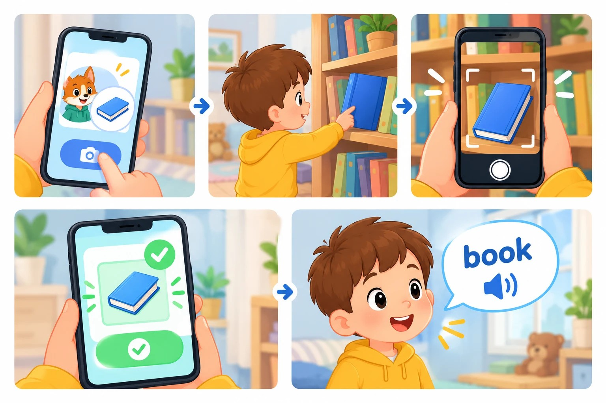
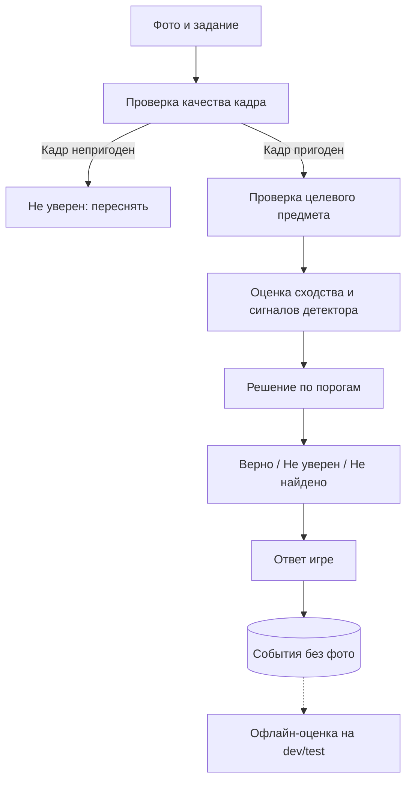

# ML System Design Doc — «Английский вокруг нас»: игра с проверкой по фото для детей 2–7 лет

**Автор:** Плехов Родион Константинович, ИТМО · **Версия:** 1.1 · **Дата:** 2026-10-25

## 1. Цели и предпосылки

### 1.1. Зачем идём в разработку продукта?

Дошкольники знакомятся с английскими словами по карточкам и картинкам, без связи с предметами вокруг, и интерес быстро пропадает. Игра устроена так: персонаж по-русски просит найти дома предмет или цвет, ребёнок фотографирует находку, игра проверяет фото, и тогда звучит английское слово. Метод опирается на обучение через действие (Total Physical Response).

**Цель:** вовлечь ребёнка и связать английское слово с настоящим предметом, который он нашёл сам.

| Цепочка эффекта | |
|---|---|
| Проблема | Слова без контекста, интерес быстро пропадает |
| Решение | Игра: задание, поиск, фото, проверка, английское слово |
| Действие | Игра засчитывает находку или просит попробовать ещё |
| Эффект | Больше слов услышано в связке с настоящим предметом |
| Деньги | Не рассматриваются: ценность определяется вовлечением, которое ещё нужно измерить |

**Нужен ли ML.** Без проверки засчитывалось бы любое фото, и смысл «слово связано с предметом» пропадает. Проверка требует понимать изображение, правилом её не заменить. Английское слово и озвучка модели не требуют.

**Какие подходы к проверке сравниваются.** Классификатор по готовому списку классов; модель сопоставления фото и текста; серверная мультимодальная модель. Подходы сравниваются **офлайн, на тестовых наборах фото, без участия пользователей**: оценивается, как каждая модель находит предмет и как часто путает (раздел 2.3).

**Успех итерации:** модель редко принимает чужой предмет и редко отклоняет правильный. Пороги фиксируются после замера бейзлайна.

### 1.2. Бизнес-требования и ограничения

**Процесс игры:** ребёнок получает задание, находит предмет дома, фотографирует его, игра проверяет фото, и звучит английское слово.

| № | Требование |
|---|---|
| БТ-1 | Задание по-русски: текст, картинка, озвучка |
| БТ-2 | Съёмка камерой устройства без установки приложения |
| БТ-3 | Проверка, что на фото нужный предмет или цвет |
| БТ-4 | Понятный ребёнку ответ |
| БТ-5 | После верного фото звучит английское слово |

**Ограничения.**
- Дети 2–7 лет и их дома: фото не должно без необходимости покидать устройство, снимки не хранятся; игра идёт со взрослым рядом (152-ФЗ). Локальная обработка сама по себе не гарантирует полного соответствия закону, поэтому до пилота нужна отдельная юридическая и privacy-проверка.
- Каждое задание должно находиться в обычной квартире: ребёнок не должен застревать на предмете, которого нет дома.
- Задания только из утверждённого безопасного списка.
- Лицензии моделей и данных проверяются по каждому источнику, ведётся реестр; для Wikimedia Commons лицензия проверяется у каждого файла.

**Ожидания от итерации.** К концу итерации должны быть получены: способ, которым игра определяет предмет на фото, выбранный по сравнению на тестовых фото из открытых наборов; пороги, по которым фото засчитывается; список слов для игры. Критерии завершения итерации приведены в 3.2.

**Бизнес-процесс пилота.** Игру проверяют на реальных пользователях: дети с родителями. Пилот вне этой итерации.

**Что считается успешным результатом.** Нужный предмет на тестовых фото из открытых наборов узнаётся заметно чаще, чем у бейзлайна, а чужие предметы принимаются редко. Конкретные значения фиксируются после замера бейзлайна. Дальше: новые наборы слов.

### 1.3. Скоуп итерации

**Закрываются БТ-1–БТ-5** для закрытого списка заданий. Входит: состав заданий по методике, сравнение подходов к проверке на тестовых наборах, решающее правило и пороги, английское слово после находки.

**Не входит:** обучение на снимках детей; распознавание речи; режим «сфотографируй что угодно» и проверка слов ребёнком по сфотографированным картинкам (не в MVP); аккаунты; серверная обработка снимков детей; пилот.

**Воспроизводимость.** Скрипты замеров в репозитории, версии моделей, наборов и порогов фиксируются, замеры запускаются при каждом изменении правил.

**Технический долг:** нет аналитики после запуска; нет замеров на слабых устройствах.

### 1.4. Предпосылки решения

- Набор заданий закрытый и расширяется; правило должно уметь «этот предмет, а не соседний».
- Детских данных для обучения нет, и храниться они не будут: старт без обучения (zero-shot).
- Цена ошибок несимметрична: ложное «верно» учит неправильному, ложное «неверно» огорчает.
- Дошкольники снимают нечётко (дрожание, ракурс, свет): тесты имитируют это искусственными искажениями.
- Слова для игры берутся из того, что учат дети, и должны находиться в обычной квартире (2.3, этап 1).

## 2. Методология

### 2.1. Постановка задачи

По фото и заданию (например, «Найди ложку!») система решает, есть ли в кадре нужный предмет или цвет. Система выбирает один из трёх ответов: **верно** (нужный предмет или цвет на фото подтверждён), **не уверен** (просим переснять: ближе или с другого ракурса) или **не найдено** (новая попытка). Слово засчитывается только при ответе «верно». Метрики:
- **полнота подтверждения (recall):** доля положительных фото целевого задания, получивших «верно»; считается по каждому классу и как макро-среднее;
- **ложное подтверждение (FAR):** доля отрицательных фото для задания, ошибочно получивших «верно»;
- **путаница:** матрица ответов «верно» для заданий списка на фото других предметов из списка;
- **ложное подтверждение вне списка (open-set):** доля фото предметов вне списка, получивших «верно» хотя бы для одного задания;
- доля ответов «не уверен», медиана и p95 времени ответа, размер модели, пиковая память, время первого запуска.

### 2.2. Блок-схема и архитектура решения

| Блок | Бейзлайн | Кандидат MVP |
|---|---|---|
| Узнавание предмета | Классификатор по готовому списку классов и/или предобученный детектор | Модель сопоставления фото и текста (zero-shot, например CLIP); при необходимости детектор для локализации объекта и передачи crop в модель |
| Цвет | Простая эвристика как контрольная точка | Цвет оценивается в области найденного предмета, а не по всему кадру; метод и ограничения фиксируются отдельно |
| Решение | Зафиксированный порог или ранжирование, настроенное на dev | Два порога для трёх исходов; правило объединения сигналов проверяется отдельно |
| Английское слово | Запись диктора | Запись диктора или синтез после проверки произношения |
| Верхний ориентир | — | Серверная мультимодальная модель на тех же открытых изображениях, только для исследовательского сравнения |

**Порядок обработки:**
1. Система получает кадр и идентификатор задания; изображение не сохраняется в постоянное хранилище.
2. Проверяется техническое качество кадра. Если он слишком размыт, тёмен или непригоден для обработки, возвращается «не уверен» с просьбой переснять.
3. Для задания на предмет оценивается целевой объект. Если используется детектор, явно определяется, нужен ли его результат для локализации, для подтверждения наличия или для обоих действий.
4. Для задания на цвет сначала определяется область предмета, если это возможно, и затем цвет оценивается внутри неё. Цвет фона не может быть достаточным основанием для подтверждения.
5. Применяются версионированное правило и пороги, возвращается один из трёх статусов.
6. Записываются только необходимые технические события, без изображения и без лишних персональных данных.

**Объединение сигналов.** Сигналы не объединяются по правилу OR без отдельного измерения: если любой компонент может подтвердить объект независимо, частота ложных подтверждений может вырасти. В эксперименте E2 измеряется вклад каждого сигнала и каждой схемы объединения.

**Оценка сходства.** У CLIP косинусное сходство показывает совместимость изображения и текстового описания и не является вероятностью правильного ответа. Softmax по конечному набору промптов даёт относительное распределение внутри набора и сам по себе не гарантирует обнаружение неизвестного объекта. «Фон» и «посторонний предмет» не универсальные классы: нужен разнообразный набор негативных изображений и описаний, промпты фиксируются, а ложные подтверждения на таких примерах измеряются отдельно.

### 2.3. Этапы решения задачи

#### Этап 1. Состав заданий

**Методика.** Слова должны быть теми, что учат дети, а предметы доступны дома.
- **Что учат дети.** Опорные тематические списки для детей: Cambridge Pre A1 Starters, темы «дом», «еда и напитки», «одежда», «игрушки», «школа» и др. Это ориентир, а не стандарт для 2–7 лет: экзамен рассчитан на 6–12 лет.
- **Как учат.** Слово связывается с действием и предметом (TPR), поэтому берутся конкретные осязаемые предметы, а не абстрактные слова.

**Критерии отбора предмета:**
1. слово есть в тематических списках для детей;
2. предмет осязаемый, называется одним словом, безопасный;
3. предмет есть почти в каждой квартире (отбираются повседневные предметы по комнатам);
4. ребёнок может его принести или снять без необходимости залезать на мебель или стремянку;
5. предмет узнаётся моделью (проверка E1).

**Порядок.** Кандидаты берутся из списков, отсеиваются по критериям 2–4, затем проверяется узнавание моделью. Не прошедшие отбрасываются.

**Кандидаты и покрытие открытыми данными** (по комнатам, подлежат проверке):

| Место | Слово | Open Images V7 | COCO |
|---|---|---|---|
| Кухня | ложка | Spoon | spoon |
| | вилка | Fork | fork |
| | чашка | Coffee cup, Mug | cup |
| | тарелка | Plate | нет |
| | миска | Bowl | bowl |
| | бутылка | Bottle | bottle |
| Комната | книга | Book | book |
| | плюшевый мишка | Teddy bear | teddy bear |
| | подушка | Pillow | нет |
| | кровать | Bed | bed |
| | стул | Chair | chair |
| | мяч | Ball | sports ball |
| Ванная | зубная щётка | Toothbrush | toothbrush |
| | полотенце | Towel | нет |
| | мыло | только Soap dispenser | нет |
| Прихожая | обувь | Footwear | нет |
| | сумка | Handbag | handbag |
| | шапка | Hat | нет |
| Одежда | носок | Sock | нет |
| | футболка | только Shirt | нет |
| Цвета | красный, синий, зелёный, жёлтый и другие | данные не нужны, цвет по пикселям | |

Слова без достаточного числа проверенных примеров исключаются из количественного сравнения или результат по ним помечается как предварительный: отсутствие данных не доказывает, что модель в принципе не распознаёт предмет. Таблица покрытия служит предварительной картой, а не подтверждением качества датасета; официальные метки и лицензии проверяются до эксперимента.

#### Этап 2. Данные для проверки модели

Детские снимки не собираются и не хранятся. Используются только открытые наборы данных.

| Данные | Есть ли данные | Ресурс | Качество проверено |
|---|---|---|---|
| Wikimedia Commons | Да, открытый | Загрузка | Нет |
| COCO, размеченные бытовые сцены | Да, открытый | Загрузка | Нет |
| Open Images V7, классы с рамками | Да, открытый | Загрузка | Нет |

**Метки и негативные примеры.**
- Метки (класс, рамка) берутся из самих наборов, но каждая сверяется с целевым словом: класс Soap dispenser не равнозначен куску мыла, а Shirt может не совпадать с узкой категорией «футболка».
- Негативные примеры: другие классы из списка, предметы вне списка, похожие по форме или цвету предметы, пустые и неинформативные кадры, а также фото экрана или картинки, если риск такого приёма входит в требования.

**Искусственные искажения.** Детская съёмка частично имитируется искажениями открытых фото: размытие, поворот, изменение масштаба, затемнение, частичное обрезание объекта. Параметры каждого искажения фиксируются. Это стресс-тест, а не замена реальным детским фотографиям.

**Разбиение.**
- Исходные изображения делятся на dev и test до создания искажений. Оригинал и все его производные остаются в одной выборке.
- По возможности в одну группу попадают близкие дубликаты и изображения одной съёмочной сессии или автора, если эти сведения доступны.
- Затем проверяется представленность каждого оцениваемого класса в обеих выборках. Целые источники механически не разделяются, если это делает распределение классов несопоставимым. Правило группировки и стратификации фиксируется в отчёте.

**Заморозка.** Модель, промпты, правило объединения сигналов и пороги выбираются на dev; test используется только для финальной оценки. Если результаты test повлияли на изменения, этот набор становится dev, и для итоговой оценки нужен новый независимый test.

**Ограничение:** открытые данные и искажения измеряют способность узнавать предмет, а не качество игры у ребёнка. Это явно указывается в результатах.

#### Этап 3. Выбор подхода к узнаванию

| Подход | Качество | Приватность | Стоимость |
|---|---|---|---|
| Классификатор ImageNet-подобный (например, MobileNetV2) | Знает не все предметы | На устройстве | Малая |
| Zero-shot фото-текст (например, CLIP) | Сопоставляет фото с фиксированными текстовыми описаниями; качество зависит от класса, промпта и кадра | На устройстве, если хватает ресурсов | Размер зависит от выбранной модели |
| Серверная мультимодальная модель | Вероятно лучшее | Фото уходят с устройства | Цена за вызов |
| Дообученный детектор | Потенциально лучше на целевых классах при достаточных размеченных данных | На устройстве | Нужны размеченные изображения целевых объектов; детские снимки не обязательны |

**Гипотеза:** zero-shot на устройстве достаточно точен, серверная модель нужна как верхний ориентир.

| Эксперимент | Что проверяется | Решение |
|---|---|---|
| E1 | Бейзлайн против zero-shot на открытых наборах | Подход для MVP |
| E2 | Вклад каждого сигнала и схем их объединения | Какие сигналы оставляем |
| E3 | Верхний ориентир: серверная модель на тех же открытых фото | Нужен ли серверный режим |
| E4 | Трудные случаи и искусственные искажения открытых фото | Нужен ли критерий «настоящий предмет» |

#### Этап 4. Решающее правило

Модель вычисляет оценку целевого класса и, если применимо, сигналы детектора и качества кадра. На dev выбираются два порога: порог подтверждения и нижний порог отказа. Выше порога подтверждения возвращается «верно», между порогами «не уверен», ниже нижнего «не найдено». Направление сравнения и значения порогов однозначно фиксируются в коде и отчёте.

«Не уверен» используется, когда пересъёмка потенциально может улучшить результат: плохое качество кадра или промежуточная оценка. Это не гарантирует, что пересъёмка поможет, и не должно превращаться в бесконечный цикл: число повторов и дальнейшее поведение игры определяются отдельно.

Косинусное сходство и softmax по заданным промптам не трактуются как калиброванная вероятность. Состав промптов, негативных примеров, модель и пороги замораживаются до финального test. Ложные подтверждения отдельно измеряются на других классах из списка и на объектах вне списка. Пороги выбираются по ожидаемой пользе, а не по F1: ложное «верно» против ложного «неверно», цены ошибок согласуются до пилота.

Для цвета фиксируются метод выделения области предмета, алгоритм оценки цвета, набор категорий и обработка неоднозначных оттенков и освещения. Если область предмета нельзя определить надёжно, цвет не подтверждается только по фону.

## 3. Подготовка пилота

### 3.1. Способ оценки пилота

Пилот вне этой итерации.

### 3.2. Что считаем успешным пилотом

| Уровень | Метрика | Роль |
|---|---|---|
| Продукт | Доля заданий, дошедших до верного ответа; число попыток; возвраты в игру | Целевая |
| ML | Полнота подтверждения, путаница | Целевая |
| ML | Ложное подтверждение вне списка | Защитная |
| Система | Время ответа, размер модели, память, первый запуск | Измерить |
| Безопасность | Доля снимков, покидающих устройство | Жёсткое ограничение (ноль) |

**Защитные метрики** показывают, не достигнут ли рост главной метрики за счёт вреда: например, вовлечение выросло, но игра стала принимать чужие предметы. Они не должны ухудшаться.

Единый контракт метрики: формула, знаменатель, окно, источник, владелец и порог. Пороги и MDE фиксируются до пилота; размер выборки и критерий остановки определяются до эксперимента. Узнавание слов после игры измеряется отдельно после MVP.

| Стадия | Что проверяется | Решение |
|---|---|---|
| Исследование | E1 | Остановить или PoC |
| PoC | Правила на dev и test, верхний ориентир E3 | Закрыть или MVP |
| Внутренний тест | Дети с родителями, наблюдение, без сохранения снимков | Доработать или пилот |
| Пилот (вне итерации) | Вовлечение, защитные метрики | Расширить, доработать или закрыть |

**Критерии завершения исследовательской итерации.** Итерация считается завершённой, когда готовы:
1. зафиксированный список заданий MVP и подтверждённое покрытие каждого оцениваемого класса;
2. воспроизводимое сравнение бейзлайна и zero-shot на одинаковых данных;
3. отчёт по полноте подтверждения, ложному подтверждению, матрице путаницы, ошибкам вне списка, доле «не уверен», задержке и размеру модели;
4. описание решающего правила, промптов, негативных примеров и порогов;
5. реестр лицензий и источников;
6. список ограничений и решение: продолжить к PoC, изменить набор заданий или остановить работу.

Численные критерии качества не задаются без измерений: после замера бейзлайна целевые значения и критерии остановки записываются до финального запуска на test. Если данных недостаточно для надёжного вывода, результат обозначается как предварительный.

### 3.3. Подготовка пилота

События без фото: идентификатор задания, результат, версия правила, оценка сходства (если нужна), время ответа и тип устройства. Оценка сходства не называется вероятностью, пока она не откалибрована как вероятность. Допустимые вычислительные затраты: вес модели и время ответа на слабом устройстве замеряются на этапе PoC, по результату задаются ограничения. Откат: флаг правил и порогов без выкладки кода.

## 4. Риски

| Причина | Риск | Мера |
|---|---|---|
| Предмета нет в квартире | Ребёнок застревает | Только повседневные предметы по комнатам; в пилоте отслеживается доля заданий, которые не удалось выполнить |
| Фото детей и люди в кадре | Нарушение приватности | Обработка на устройстве, снимки не хранятся, отдельная юридическая проверка до пилота |
| Несколько сигналов объединяются по ИЛИ | Много ложных подтверждений | Не объединять без измерения; вклад каждого сигнала измеряется в E2 |
| Посторонний предмет «прилипает» к похожему заданию | Обман ребёнка | Разнообразный набор негативных примеров, защитная метрика |
| Ребёнок снимает экран или картинку | Ложное подтверждение | Критерий «настоящий предмет», тест E4 |
| Детские снимки нечёткие | Много отказов | Проверка качества кадра, ответ «не уверен» с просьбой переснять, искажения в тестах |
| Модели обучены на западных данных | Хуже на российских бытовых фото | В тестовые наборы включаются разнообразные бытовые сцены; ограничение указывается явно |
| Неверное произношение | Ребёнок запоминает неправильно | Запись диктора, проверка носителем |
| Небезопасное задание | Ребёнок ищет опасный предмет | Утверждённый список, ревью заданий |
| Лицензии моделей и данных | Нельзя использовать или выпускать | Реестр лицензий, проверка по каждому файлу и модели, атрибуция |
| Нет детских данных | Реальное качество неизвестно | Искажения открытых фото в тестах, явное указание ограничения |

## 5. Открытые вопросы

- Минимальное целевое устройство и допустимое время первого запуска.
- Нужен ли серверный режим как запасной, если локальная модель не достигает заранее согласованных критериев качества.
- Запись диктора или синтез для английских слов.

## 6. Журнал решений

| Дата | Решение | Обоснование |
|---|---|---|
| 2026-10-25 | Проект: игра с английскими словами | Данные доступны, качество измеримо |
| 2026-10-25 | Название: «Английский вокруг нас» | Мир вокруг как учебник |
| 2026-10-25 | Состав заданий: из тематических списков для детей и по наличию дома | Ребёнок не должен застревать |
| 2026-10-25 | Проверка по закрытому списку, zero-shot | Нет данных детей |
| 2026-10-25 | Снимки детей не хранятся | Приватность |
| 2026-10-25 | Подходы сравниваются офлайн на тестовых наборах | Оценить модель без пользователей |
| 2026-10-25 | Пороги подбираются на dev, итог на test | Избежать оптимистичной оценки |
| 2026-10-25 | Оценка сходства не называется вероятностью | Она не откалибрована |
| 2026-10-25 | Сигналы не объединяются по OR без измерения | Растут ложные подтверждения |
| 2026-10-25 | Числовые пороги не придумываются | Фиксируются после измерений на бейзлайне |

## Приложение: термины

**Zero-shot** — модель без дообучения на данных проекта. **Фото-текст модель** — сопоставляет изображение и текстовое описание. **Recall (полнота подтверждения)** — доля положительных примеров, получивших «верно». **FAR (ложное подтверждение)** — доля отрицательных примеров, ошибочно получивших «верно». **Open-set** — предметы вне списка заданий. **Путаница** — засчитано другое задание из списка. **dev / test** — выборки для подбора и для итоговой оценки. **Защитная метрика** — показатель, который не должен ухудшаться при росте главной метрики.
