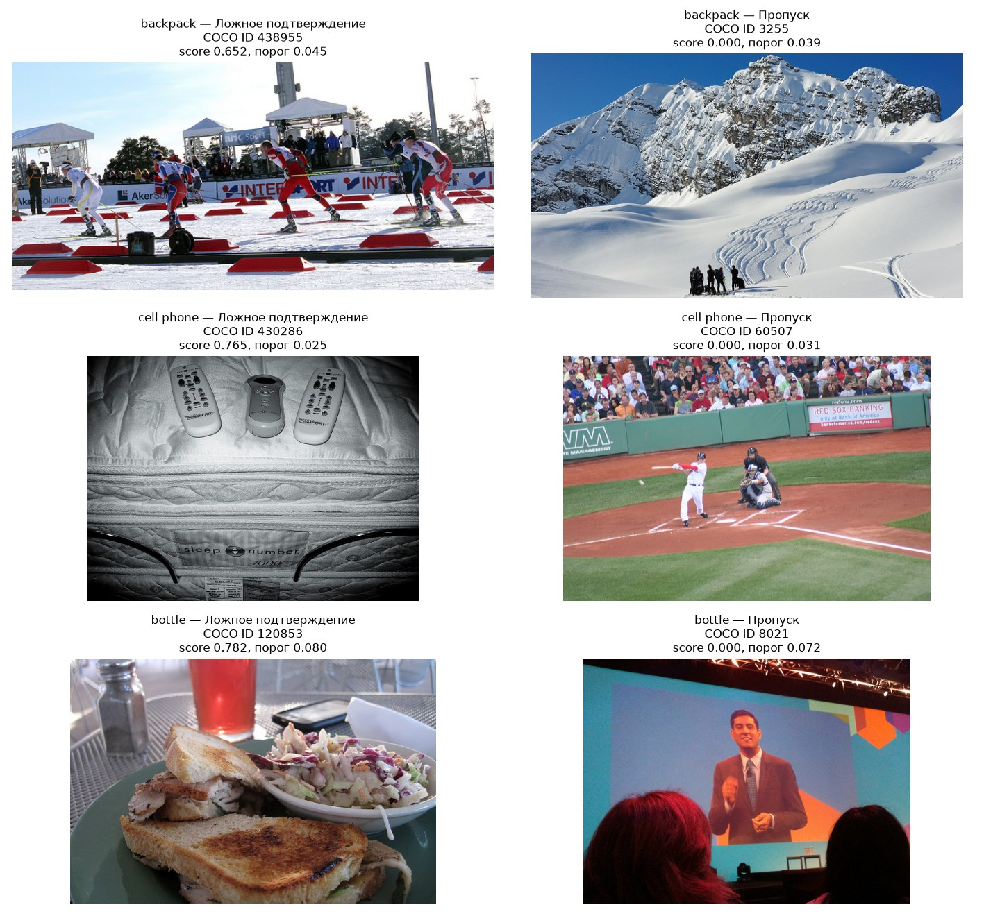

# EDA и сравнение моделей

В ДЗ №2 исследован COCO val2017 и сравнены предобученные MobileCLIP-S0, YOLOv8n и YOLO11n. Модели проверены на всех 5 000 изображениях. В количественное сравнение вошли 26 игровых классов с минимум 100 положительными фотографиями на класс.

## Данные

В наборе 5 000 изображений, 36 781 аннотация и 80 категорий. Аудит файлов и разметки показал нулевое число ошибок чтения, некорректных рамок, повторов ID и точных дубликатов JPEG. Сведения о лицензиях сохранены из метаданных COCO. [Аудит изображений](kaggle_hw2_results/image_audit.csv) · [Лицензии](kaggle_hw2_results/licenses.csv)

В предварительном каталоге 58 заданий. Для 38 нашлась подходящая категория COCO, для 20 нужна отдельная разметка. Ещё 12 сопоставленных классов исключены из метрик из-за недостаточного объёма данных. В статистике сохранены все 38 классов и признак `included_in_benchmark`. Минимум 100 положительных фото даёт хотя бы 20 таких примеров в каждой из пяти оценочных частей. [Каталог заданий](kaggle_hw2_results/task_inventory.csv) · [Статистика классов](kaggle_hw2_results/class_stats.csv)

Положительная метка означает, что целевой класс размечен на фото, включая `iscrowd`. При отсутствии этой метки фото считается отрицательным для задания. Поэтому пропущенная аннотация может повлиять на оценку FAR и AP. Один снимок может быть положительным для нескольких заданий.

Хотя бы один из 26 классов размечен на 3 027 фото. На 1 188 снимках выбранных классов несколько, а на 1 973 выбранные метки отсутствуют. Совместная встречаемость и малый размер объектов важны для игры, поскольку кадр может содержать много деталей и посторонних предметов. В частности, 72,2% отдельных бутылок и 63,0% телефонов занимают меньше 1% площади фото.

Предварительный каталог включает уличные задания. Состав домашнего MVP будет отобран отдельно по безопасности и доступности предметов. Все 26 классов сохранены в текущем эксперименте, чтобы оценить доступные данные и сравнить готовые модели.

## Протокол сравнения

Для YOLO score присутствия класса равен максимальной уверенности его детекций, а при их отсутствии — нулю. MobileCLIP использует сходство изображения и фиксированного текста `a photo of {object}.`. Веса моделей зафиксированы, дообучение в этом эксперименте отсутствует.

Основная метрика macro AP усредняет качество ранжирования по классам с одинаковым весом. Это учитывает дисбаланс положительных и отрицательных примеров и даёт одинаковый вклад каждому игровому заданию. ROC AUC дополняет сравнение ранжирования. Recall показывает, какую долю правильных находок игра подтверждает, а FAR — какую долю отрицательных примеров ошибочно принимает.

Пороги калибровались по отрицательным примерам на четырёх фолдах и проверялись на пятом. Recall и FAR рассчитаны по объединённым out-of-fold ответам. Порог `confidence_95pct` добавляет запас по односторонней биномиальной границе с уровнем доверия 95%. FAR 5% служит условием этого эксперимента. Продуктовый предел предстоит согласовать до проверки целевого test. Метрики в таблице усреднены по классам.

## Сравнение моделей

В таблице приведён консервативный протокол `confidence_95pct`. AP при IoU 0.50 оценивает локализацию у детекторов.

| Модель | Macro AP | ROC AUC | Recall | FAR | Классов с FAR >5% | mAP@0.50 |
|---|---:|---:|---:|---:|---:|---:|
| MobileCLIP-S0 | 0,597 | 0,892 | 67,1% | 4,41% | 0/26 | — |
| YOLOv8n | 0,806 | 0,959 | 87,6% | 4,42% | 0/26 | 0,568 |
| **YOLO11n** | **0,821** | 0,956 | **88,4%** | **4,26%** | **0/26** | **0,591** |

YOLO11n выбран кандидатом по macro AP и поведению при консервативном пороге. Его преимущество над YOLOv8n по среднему recall составляет около 0,85 процентного пункта. У YOLOv8n выше ROC AUC. Статистическая значимость различий в этой работе отдельно не оценивалась.

На эмпирическом пороге FAR превышает 5% у 13 классов MobileCLIP, 17 классов YOLOv8n и 12 классов YOLO11n. Это показывает необходимость проверки фактических ответов на отложенных фото после калибровки. Полные результаты обоих протоколов сохранены по каждому классу. [Метрики моделей](kaggle_hw2_results/model_metrics.csv) · [Метрики классов](kaggle_hw2_results/per_class_metrics.csv)

## Разбор ошибок YOLO11n

Для рюкзака, телефона и бутылки рассмотрены ответы при `confidence_95pct`. Ложные подтверждения считаются среди фото без целевой метки, пропуски — среди фото с ней.

| Класс | Положительных фото | Верно подтверждено | Пропуски | Ложные подтверждения | Recall |
|---|---:|---:|---:|---:|---:|
| backpack | 228 | 134 | 94 | 213 | 58,8% |
| cell phone | 214 | 153 | 61 | 211 | 71,5% |
| bottle | 379 | 295 | 84 | 204 | 77,8% |

Для каждого класса выбрано по одному ложному подтверждению с наибольшим score и по одному пропуску с наименьшим score. При равенстве использован порядок COCO ID. Этот способ отбора воспроизводим и показывает крайние ошибки. Для оценки их распространённости используются все ответы класса.

В случае телефона COCO ID 430286 модель с уверенностью 0,765 принимает фото пультов управления. Это пример путаницы похожих по форме предметов. У пропущенного телефона на фото 60507 основную часть кадра занимает бейсбольный матч со зрителями. Нужный класс присутствует по разметке, однако score равен нулю.

У рюкзака пропуск на фото 3255 приходится на далёкую группу людей на фоне гор. В ложном подтверждении 438955 на переднем плане спортивной сцены видны сумки. Для бутылки ложное подтверждение 120853 возникает на фото еды с посудой и небольшими ёмкостями. Такие случаи требуют проверки границ категорий и возможных пропусков разметки. Пропуск бутылки 8021 относится к сцене с большим экраном и мелкими деталями.

По этим примерам нельзя установить, какую именно рамку модель использовала для ошибочного подтверждения, поскольку в архиве сохранены score присутствия и итоговый AP50. Метки и основные метрики оставлены в исходном виде. Разбор поддерживает два следующих шага — проверку мелких объектов и добавление похожих предметов в целевые негативные примеры.

COCO ID, тип ошибки, score, порог и фолд всех ошибок выбранных трёх классов доступны в таблице. [Случаи ошибок](kaggle_hw2_results/error_cases.csv)

## Что делать дальше

Перед PoC нужно утвердить безопасный домашний каталог и подготовить отдельные dev/test из целевых бытовых фото. Разбиение будет выполнено по домохозяйствам и сессиям съёмки. На dev выбираются пороги и правила отказа, затем фиксируются и проверяются на test. План объёма данных, проверки цвета, интеграции и пилота приведён в дизайн-документе. [Этапы решения](../../docs/ml_system_design_doc.md#23-этапы-решения-задачи)

Основной прогон выполнен в Kaggle на T4. Разбор ошибок рассчитан на CPU из сохранённых результатов. Версии окружения и хэши весов относятся к прогону Kaggle. [Артефакты](kaggle_hw2_results/) · [Выполненный ноутбук](../../notebooks/01_coco_eda.ipynb)
